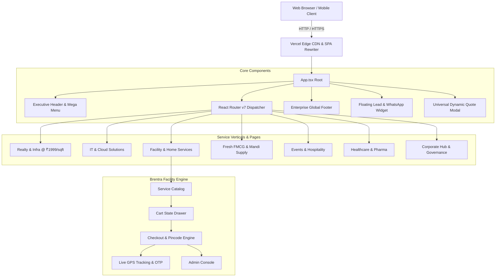

<div align="center">

# 🏛️ BENTRA VENTURES & VENTRA GROUP

### *The Enterprise Conglomerate Platform & Multi-Vertical Service Ecosystem*
**Headquartered in Bailey Road, Patna, Bihar, India**

[](https://github.com/rameez-1807/BENTRA-VENTURES/actions/workflows/ci.yml)
[](https://bentra-ventures.vercel.app)
[](https://bentra-ventures.onrender.com/api/health)
[](https://supabase.com/)
[](https://vitejs.dev/)
[](https://react.dev/)
[](https://www.typescriptlang.org/)
[](https://tailwindcss.com/)
[](LICENSE)

<br/>

### 🌐 **Live Production Frontend:** [https://bentra-ventures.vercel.app](https://bentra-ventures.vercel.app)
### ⚡ **Live Production Backend:** [https://bentra-ventures.onrender.com](https://bentra-ventures.onrender.com/api/health)
### 🗄️ **Supabase Database Project:** `cqejrdwdddelpdlizbih` (PostgreSQL 17 — Tokyo Cluster)

<br/>

<br/>

> **"One Vision • Multiple Businesses • Bigger Future"**  
> *Diverse Ventures | Stronger Tomorrow*

<br/>

[](https://vercel.com/new/clone?repository-url=https://github.com/rameez-1807/BENTRA-VENTURES)

<br/>

[Live Verticals](#-business-verticals--routing-directory) • [Facility Engine](#-brentra-facility-services-booking-engine) • [Architecture](#-system-architecture) • [Getting Started](#-getting-started) • [Deployment](#-deployment-guide) • [Contact](#-corporate-headquarters--contact)

---

</div>

## 📌 Table of Contents

- [🏛️ Corporate Overview](#-corporate-overview)
- [⚡ Key Features & Highlights](#-key-features--highlights)
- [🗺️ Business Verticals & Routing Directory](#-business-verticals--routing-directory)
- [🛒 Brentra Facility Services Booking Engine](#-brentra-facility-services-booking-engine)
- [🏗️ System Architecture](#-system-architecture)
- [🛠️ Technology Stack](#-technology-stack)
- [📂 Repository Structure](#-repository-structure)
- [🚀 Getting Started](#-getting-started)
  - [Prerequisites](#prerequisites)
  - [Installation & Local Run](#installation--local-run)
  - [Building for Production](#building-for-production)
- [🌐 Deployment Guide](#-deployment-guide)
  - [Vercel (Recommended)](#1-deploying-to-vercel-recommended)
  - [Netlify & Static Hosts](#2-deploying-to-netlify--static-hosts)
- [🎨 Brand Identity & Design System](#-brand-identity--design-system)
- [📞 Corporate Headquarters & Contact](#-corporate-headquarters--contact)
- [📄 License](#-license)

---

## 🏛️ Corporate Overview

**Brentra Ventures Pvt. Ltd.** (alongside **Ventra Group of Companies**) is a diversified enterprise conglomerate operating across Eastern India with strategic expansion hubs in Patna, Bihar. 

The organization powers high-growth business sectors ranging from heavy infrastructure construction and turnkey residential execution to enterprise IT engineering, mechanized environmental sanitization, cold-chain fresh FMCG logistics, and high-profile luxury event hospitality.

```
                                  ┌────────────────────────┐
                                  │ BENTRA VENTURES PVT.   │
                                  │  Executive Directorate │
                                  └───────────┬────────────┘
         ┌──────────────────┬─────────────────┼─────────────────┬──────────────────┐
         ▼                  ▼                 ▼                 ▼                  ▼
┌─────────────────┐ ┌───────────────┐ ┌───────────────┐ ┌───────────────┐ ┌─────────────────┐
│ Realty & Infra  │ │ IT & Software │ │ Facility Ops  │ │ Fresh FMCG    │ │ Luxury Events   │
│ Turnkey ₹1999   │ │ Web & AI Apps │ │ Mechanized    │ │ Cold-Chain    │ │ & Hospitality   │
└─────────────────┘ └───────────────┘ └───────────────┘ └───────────────┘ └─────────────────┘
```

---

## ⚡ Key Features & Highlights

- **Executive Conglomerate Gateway:** Unified multi-vertical routing structure with single-click navigation between 15 corporate divisions and regional subsidiaries.
- **Dynamic Turnkey Real Estate Calculator:** Built-in ₹1,999 / sq. ft. construction estimator with material grading specifications (550D TMT, 53-grade cement, vitrified flooring).
- **Interactive IT & Digital Estimators:** 30-minute architecture discovery booking, sprint cost calculators, and stack capability matrices.
- **Urban Facility Services On-Demand Platform:** Full e-commerce service booking workflow including cart management, instant checkout, simulated live GPS tracking with 4-digit OTP, and executive admin operational dashboard.
- **Universal Multi-Step Lead Engine:** Context-aware quote request modal (`QuoteModal`) dynamically tailored to each vertical.
- **Persistent Accessibility & Floating Widget:** 1-click direct WhatsApp integration, emergency technician call dispatch, and multi-tier quotation triggers.
- **Responsive Executive Design:** Curated navy (`#0A192F`), corporate slate (`#1E3E62`), and warm gold accent palette with glassmorphism.

---

## 🗺️ Business Verticals & Routing Directory

| Vertical / Service | Route Path(s) | Primary Capabilities & Core Deliverables |
| :--- | :--- | :--- |
| **🏠 Realty & Turnkey Construction** | `/realty-infrastructure`<br>`/construction-services` | Flat ₹1,999/sq. ft. turnkey home building guarantee, structural engineering, architectural blue-printing, interior design, bulk construction raw materials supply. |
| **💻 IT & Digital Solutions** | `/it-solutions`<br>`/it-services` | Enterprise SaaS development, cross-platform mobile apps (Flutter/React Native), AI agent automations, cloud infrastructure, dedicated tech staffing. |
| **📈 Digital Marketing & Growth** | `/digital-marketing`<br>`/marketing-services` | ROI-driven Meta/Google Ads performance campaigns, SEO dominance, corporate brand architecture, B2B lead generation pipelines. |
| **👥 Manpower & Housekeeping** | `/manpower-housekeeping`<br>`/manpower-services` | PSARA-compliant verified security personnel, corporate housekeeping, facility stewards, industrial technicians for hospitals, banks, and IT parks. |
| **💧 RO Water Purifier Solutions** | `/ro-water-purifier`<br>`/ro-services` | Residential RO repair, industrial 50–1000 LPH plant installation, membrane replacement, scheduled filter maintenance, AMC packages. |
| **🧼 Mechanized Tank Cleaning** | `/water-tank-cleaning`<br>`/tank-cleaning` | 6-stage mechanized scientific cleaning, high-pressure slurry pumping, anti-bacterial UV sterilization for residential & commercial tanks. |
| **🛡️ Certified Herbal Pest Control** | `/pest-control`<br>`/pest-control-services` | 100% odorless herbal termite treatment, anti-cockroach gel piping, rodent management, bed bug elimination with 1–3 year written warranty. |
| **🛠️ Brentra Facility Services** | `/facility-services`<br>`/brentra-facility`<br>`/home-services`<br>`/urban-services` | Urban on-demand doorstep service platform with live cart, checkout, live technician tracking, and multi-service catalog. |
| **🌾 Fresh Supply & FMCG** | `/fresh-fmcg` | Daily Patna wholesale rate ticker, Mithila Makhana export, poultry processing, farm eggs, river fish logistics, and Ventra gourmet ice cream. |
| **🎉 Events & Royal Hospitality** | `/events-hospitality` | Destination royal wedding management, corporate executive summits, institutional banquet catering (100 to 5,000+ pax). |
| **🏥 Healthcare & Pharma Ventures** | `/ventures` | Wholesale pharma supply chain, temperature-sensitive cold chain distribution (2°C–8°C), third-party logistics (3PL) warehousing. |
| **🏛️ Corporate Overview** | `/corporate-overview` | Conglomerate history, corporate charter, vision, board of directors, and enterprise governance framework. |
| **📍 Patna Regional Hub** | `/patna-hub` | Regional control centre, cold storage depots, construction distribution yards, and 18-district Bihar transit network. |
| **💼 Careers & Empanelment** | `/careers` | Job openings across all 7 verticals, talent applications, vendor and civil contractor onboarding portal. |

---

## 🛒 Brentra Facility Services Booking Engine

The platform features a proprietary on-demand facility booking suite located under `src/components/facility/`:

```
┌─────────────────────────────────────────────────────────────────────────────┐
│                   Brentra Facility End-to-End Workflow                      │
└─────────────────────────────────────────────────────────────────────────────┘
  1. Service Catalog       2. Cart Drawer       3. Express Checkout
  [ServiceDetailModal] ──► [CartDrawer]    ──► [CheckoutModal]
                                                     │
                                                     ▼
  5. Executive Admin       4. OTP Verification & Dispatch
  [AdminDashboardModal] ◄─ [LiveTrackingModal] (4-Digit GPS Tracking)
```

1. **Service Catalog & Detail Modal (`ServiceDetailModal.tsx`):**
   - High-definition service breakdown, package inclusions, price tiers, and duration estimates.
2. **Interactive Cart Drawer (`CartDrawer.tsx`):**
   - Dynamic quantity increments, itemized tax computations, promo voucher code engine, and smooth drawer animations.
3. **Multi-Step Checkout Modal (`CheckoutModal.tsx`):**
   - Address picker with Patna pincode validation, appointment slot selector, and payment method selection (Cash on Delivery, UPI, Net Banking).
4. **Live Technician GPS Tracking (`LiveTrackingModal.tsx`):**
   - Simulated real-time dispatch progress (*Assigned ➔ Out for Service ➔ Reached ➔ Work Completed*).
   - Dynamic 4-digit security OTP verification and technician direct phone dispatch.
5. **Administrative Dispatch Console (`AdminDashboardModal.tsx`):**
   - Live revenue metrics, pending orders queue, status toggles, and operational control for facility managers.

---

## 🏗️ System Architecture



---

## 🛠️ Technology Stack

| Layer | Technologies Used |
| :--- | :--- |
| **Core Framework** | [React 19.3](https://react.dev/) + [TypeScript 6.0](https://www.typescriptlang.org/) |
| **Bundler & Tooling** | [Vite 8.3](https://vitejs.dev/) with Fast Refresh & Rolldown architecture |
| **Routing** | [React Router v7](https://reactrouter.com/) with hash anchor smooth-scrolling |
| **Styling & Design System** | [Tailwind CSS v4](https://tailwindcss.com/) with modern CSS variables |
| **Component Icons** | [Lucide React](https://lucide.dev/) (200+ clean modern SVG icons) |
| **CI / CD Pipeline** | GitHub Actions (`.github/workflows/ci.yml`) |
| **Cloud Hosting** | [Vercel](https://vercel.com/) with zero-config `vercel.json` SPA rewrite rules |

---

## 📂 Repository Structure

```text
BENTRA-VENTURES/
├── .github/
│   └── workflows/
│       └── ci.yml              # Automated CI build & TypeScript type checking
├── public/                     # High-resolution assets, logos, and favicons
│   ├── b-logo.png              # Brentra monogram emblem
│   ├── brentra-full-logo.png   # Brentra primary horizontal brandmark
│   ├── brentra-logo.png        # Official Brentra crest
│   ├── ventra-logo.png         # Official Ventra corporate crest
│   ├── favicon.svg             # Modern scalable vector favicon
│   └── ...                     # High-res photography for all verticals
├── src/
│   ├── assets/                 # SVGs, banners, and static media
│   ├── components/             # Reusable enterprise UI component modules
│   │   ├── facility/           # Brentra Facility on-demand booking engine
│   │   │   ├── AdminDashboardModal.tsx
│   │   │   ├── CartDrawer.tsx
│   │   │   ├── CheckoutModal.tsx
│   │   │   ├── LiveTrackingModal.tsx
│   │   │   └── ServiceDetailModal.tsx
│   │   ├── DirectorsQuad.tsx   # Executive leadership quad presentation
│   │   ├── FloatingWidget.tsx  # Persistent quick-action conversion dock
│   │   ├── Footer.tsx          # Comprehensive enterprise multi-column footer
│   │   ├── Header.tsx          # Executive responsive navbar & service mega-menu
│   │   ├── HeroCarousel.tsx    # High-impact cinematic carousel
│   │   ├── ParentStats.tsx     # Live corporate milestone counters
│   │   └── QuoteModal.tsx      # Universal dynamic lead generation modal
│   ├── data/                   # Structured data, pricing tables, and service arrays
│   ├── pages/                  # 15 dedicated enterprise vertical and hub pages
│   │   ├── CareersPage.tsx
│   │   ├── CorporateOverviewPage.tsx
│   │   ├── DigitalMarketingPage.tsx
│   │   ├── EventsHospitalityPage.tsx
│   │   ├── FacilityServicesPage.tsx
│   │   ├── FreshFMCGPage.tsx
│   │   ├── HomePage.tsx
│   │   ├── ITSolutionsPage.tsx
│   │   ├── ManpowerServicesPage.tsx
│   │   ├── PatnaHubPage.tsx
│   │   ├── PestControlPage.tsx
│   │   ├── ROServicesPage.tsx
│   │   ├── RealtyPage.tsx
│   │   ├── VenturesPage.tsx
│   │   └── WaterTankCleaningPage.tsx
│   ├── types/                  # TypeScript interface declarations
│   ├── App.tsx                 # Master routing table & layout coordinator
│   ├── index.css               # Global Tailwind CSS definitions & typography
│   └── main.tsx                # React DOM root entry point
├── .gitignore                  # Git tracking exclusion list
├── index.html                  # HTML entry template with meta tags & SEO schema
├── LICENSE                     # MIT Open Source License
├── package.json                # Project dependencies & operational scripts
├── tsconfig.json               # TypeScript compilation configuration
├── vercel.json                 # Vercel SPA rewrite fallback configuration
├── vite.config.ts              # Vite server & plugins configuration
└── README.md                   # Complete repository documentation
```

---

## 🚀 Getting Started

### Prerequisites

Ensure you have the following installed on your machine:
- **Node.js**: `v18.0.0` or higher (`Node.js 20+ LTS` recommended)
- **npm**: `v9.0.0` or higher (or `pnpm` / `yarn`)
- **Git**: Installed and configured

### Installation & Local Run

1. **Clone the repository:**
   ```bash
   git clone https://github.com/rameez-1807/BENTRA-VENTURES.git
   cd BENTRA-VENTURES
   ```

2. **Install project dependencies:**
   ```bash
   npm install
   ```

3. **Launch the local development server:**
   ```bash
   npm run dev
   ```
   Open your browser and navigate to `http://localhost:5173`.

### Building for Production

To validate types and compile an optimized production distribution:

```bash
# Type check and build distribution to /dist
npm run build

# Preview the production build locally
npm run preview
```

---

## 🌐 Deployment Guide

### 1. Deploying to Vercel (Recommended)

This project includes zero-config routing rules in `vercel.json` to handle React Router client-side routing seamlessly:

[](https://vercel.com/new/clone?repository-url=https://github.com/rameez-1807/BENTRA-VENTURES)

#### Via Vercel Web Dashboard:
1. Go to [Vercel Dashboard](https://vercel.com/new).
2. Click **"Import"** next to `rameez-1807/BENTRA-VENTURES`.
3. Set Framework Preset to **Vite**.
4. Click **Deploy**.

#### Via Vercel CLI:
```bash
npm install -g vercel
vercel
```

### 2. Deploying to Netlify / Static Hosts

Add a `_redirects` file to `public/_redirects` (or configure your server rewrites):
```text
/*    /index.html   200
```

---

## 🎨 Brand Identity & Design System

The visual design language is calibrated for a trustworthy, high-status enterprise corporate presence:

| Element | Specification | Hex Code | Visual Sample |
| :--- | :--- | :--- | :--- |
| **Deep Executive Navy** | Primary headers, top-tier badges, corporate emphasis | `#0A192F` | `rgb(10, 25, 47)` |
| **Royal Corporate Blue** | Interactive buttons, active tab indicators, links | `#1E3E62` | `rgb(30, 62, 98)` |
| **Warm Heritage Gold** | Accents, luxury hospitality tags, verified badges | `#C5A880` | `rgb(197, 168, 128)` |
| **Crisp Porcelain White** | Core background canvas, clean card surfaces | `#FFFFFF` | `rgb(255, 255, 255)` |
| **Slate Tone** | Subtle borders, muted body text, technical specs | `#475569` | `rgb(71, 85, 105)` |

---

## 📞 Corporate Headquarters & Contact

| Department | Contact Coordinates |
| :--- | :--- |
| **Headquarters** | Brentra & Ventra Corporate Towers, Bailey Road, Patna, Bihar — 800001 |
| **Regional Facilities Depot** | Transport Nagar & Gola Road Distribution Centre, Patna |
| **Central Helpline** | `+91-94300-88000` / `+91-91234-56789` |
| **Official Corporate Email** | `corporate@ventragroup.in` / `contact@brentraventures.com` |
| **Business Development** | `partnerships@ventragroup.in` |
| **Careers & HR** | `careers@ventragroup.in` |

---

## 📄 License

This project is licensed under the [MIT License](LICENSE) — see the LICENSE file for details.

---

<div align="center">

*© 2026 Brentra Ventures Pvt. Ltd. & Ventra Group of Companies. All rights reserved.*  
*Empowering Bihar & Eastern India with World-Class Enterprise Services.*

</div>
